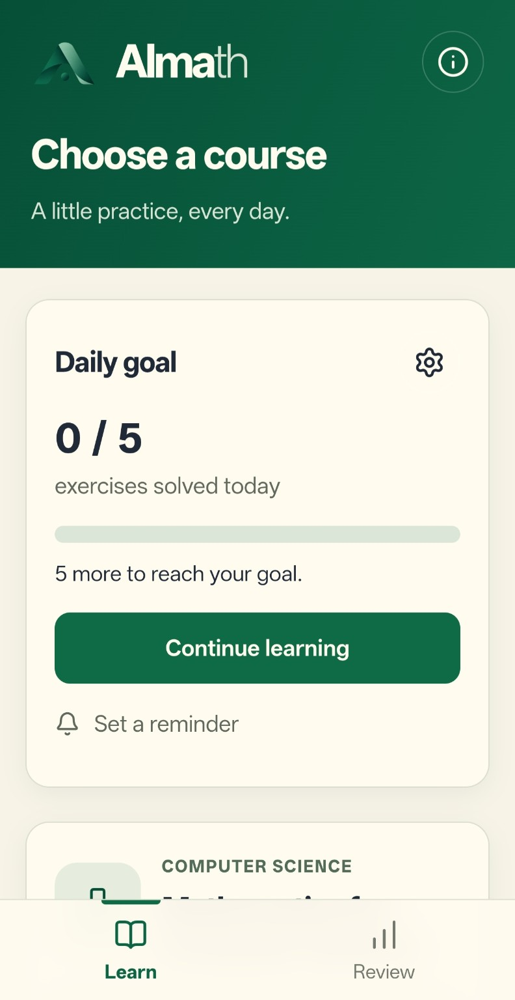
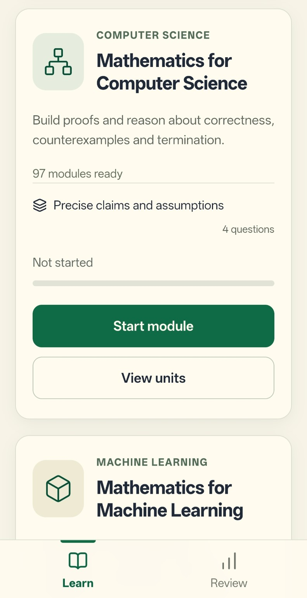
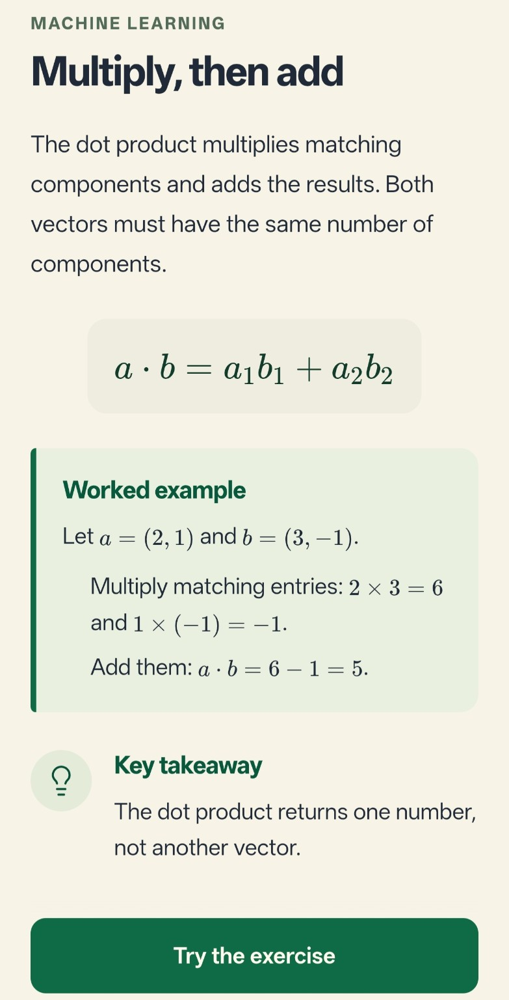
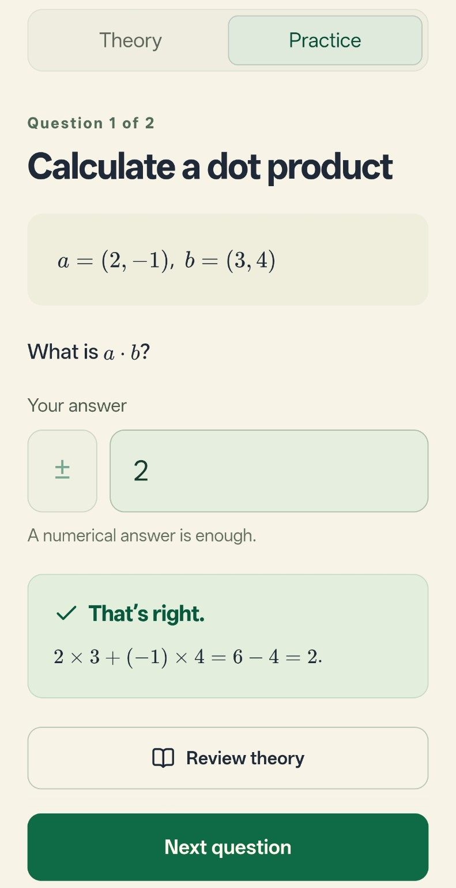
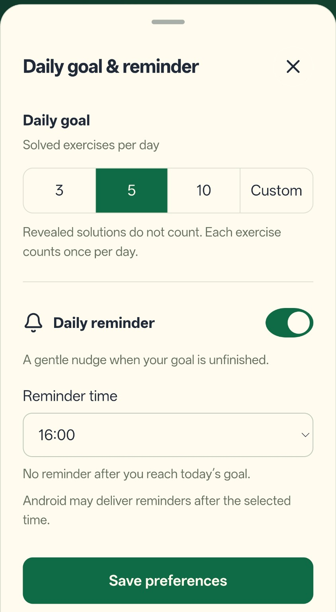

# Almath

Repository for **Almath — Active Learning Maths**, developed by Alberto Moro Carrera, which helps students and working engineers learn and review mathematics for Computer Science and Machine Learning through short explanations, worked examples and interactive exercises.

The app is designed for short learning sessions: understand a concept, try it yourself and continue from where you stopped. The Android version includes offline learning, daily goals and optional local reminders.

**Screenshots:**

| Home and daily progress | Course selection |
| :---: | :---: |
|  |  |
| **Theory and worked example** | **Exercise and answer feedback** |
|  |  |

**Daily goals and reminders:**



**How it works:**

- Choose a course and module. Read the explanation and follow a worked example before moving on to the exercises.
- Submit an answer to receive feedback. Hints are optional: an incorrect answer invites you to request one, without duplicating the hint. Solutions include an explanation.
- Revisit the theory, resume an unfinished module or use review mode to practise again.
- Set a daily target between 1 and 100 exercises. Each correctly answered exercise counts once per day; revealed solutions do not count towards the goal.
- On Android, optionally enable a reminder at your chosen time. Reminders work offline and are skipped when the daily goal has been reached. Delivery time can vary with Android battery settings.

**Current courses:**

**Mathematics for Computer Science:** 22 units, 97 active modules and 310 original exercises covering proofs, logic, sets, induction, algorithms, graphs, number theory, counting, probability, random walks and recurrences.

**Mathematics for Machine Learning:** 12 modules and 74 original exercises covering vectors, regression, optimization, classification, probability, regularization, evaluation, neural networks, attention and ML systems.

The interface and learning content are in English. An account is not required: progress is saved locally using IndexedDB, with no cross-device synchronization. Clearing browser/app data or uninstalling the app can remove your progress. Android bundles the lessons and mathematical fonts for offline use; external reference links require an internet connection.

**Try the Android beta:**

Download the APK attached to an [Android release](https://github.com/albertoM02/Almath/releases) and install it on Android 7.0 or later. Android may ask you to allow installation from the app used to download it. Updates with the same application ID and signing certificate preserve app data.

**Run locally:**

Developed using TypeScript, React 19, Next.js 16 and Tailwind CSS 4, with KaTeX for mathematical notation. Android uses Capacitor 8 and Java for the native reminder scheduler.

Requires Node.js 22.13.0 or later and pnpm 11.25.0.

```bash
git clone --branch feature/android https://github.com/albertoM02/Almath.git
cd Almath
pnpm install --frozen-lockfile
pnpm dev
```

Open [http://localhost:3000](http://localhost:3000). Use `pnpm check` for lint, TypeScript, content validation and tests, or `pnpm build` for a production web build.

**Build Android:**

Requires JDK 21 and the Android SDK with API 36 and its build tools. Configure `JAVA_HOME` and the SDK location through `ANDROID_HOME` or `android/local.properties`. See the [Capacitor environment setup](https://capacitorjs.com/docs/getting-started/environment-setup).

```bash
pnpm android:apk
```

This exports and verifies the offline web bundle, synchronizes Capacitor and creates an APK for local testing at `android/app/build/outputs/apk/debug/app-debug.apk`.

**Folder overview:**

**app:** Next.js entry point, page layout and global styles.

**screens:** Course, unit, lesson, review, completion and About screens.

**components:** Shared interface elements and Almath components, including mathematical text and daily goals.

**content:** Courses, modules, concepts, exercises, English text and reference metadata, separate from the interface.

**learning:** Answer checking, sessions, progress validation, local storage, navigation and daily goal calculations.

**platform:** Android integration, including Back navigation and reminders.

**android:** Native Capacitor project, resources and the local reminder scheduler.

**scripts / tests:** Build scripts, content validation and regression tests.

**public / assets:** App logo and README screenshots.

**Content and attribution:**

The explanations and exercises are written for Almath. The Computer Science curriculum is informed by *Mathematics for Computer Science* by Eric Lehman, F. Thomson Leighton and Albert R. Meyer (June 2018), published under [CC BY-SA 3.0](https://creativecommons.org/licenses/by-sa/3.0/). The book's text and exercises are not reproduced here. Machine Learning references include Google ML Crash Course, Stanford CS229 and other primary technical sources, listed in `content/sources.json`. The exercises are original practice material and are not presented as questions asked by a particular company.

**Contributing:**

Suggestions, bug reports and corrections are welcome through [GitHub Issues](https://github.com/albertoM02/Almath/issues). For a content correction, include the course, module and exercise involved. If Almath is useful to you, a star helps others discover the project.

Alberto Moro Carrera
